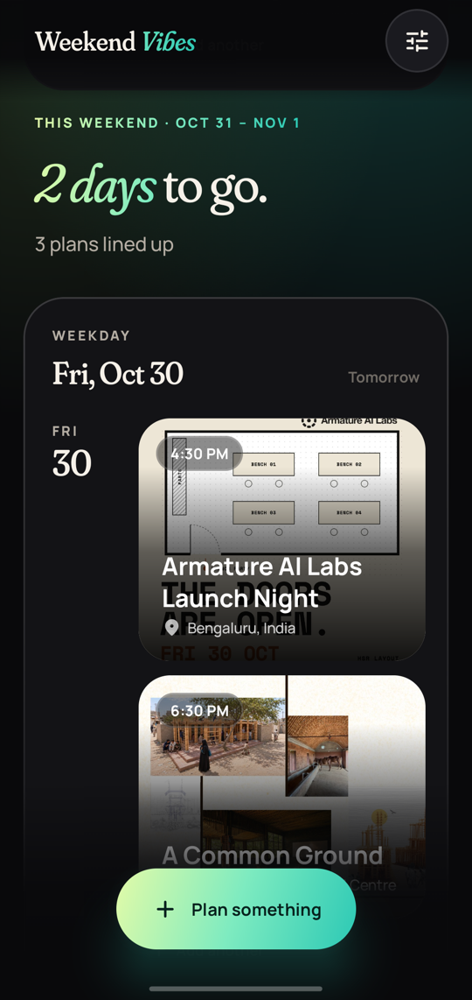
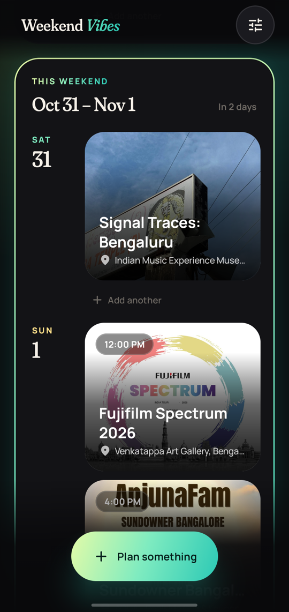
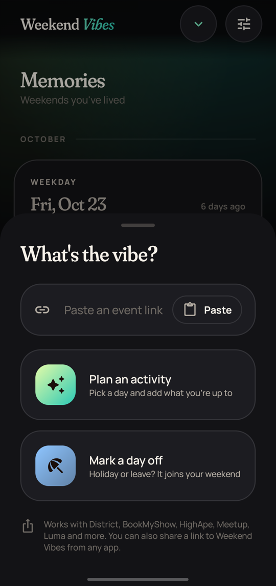
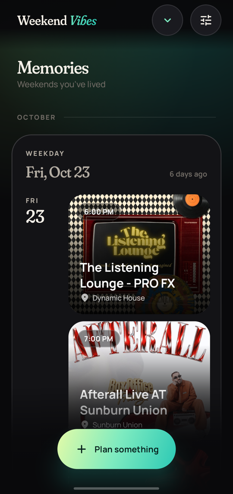

# Weekend Vibes

What am I doing this weekend, and what did I do last time? Weekend Vibes is a weekend-only planner and journal for Android. There's no account, and your plans stay on your phone.

<p align="center">
  
  
  
  
</p>

## What it does

- **Only weekends.** Every Saturday and Sunday in one list, plus any day off you mark. A Friday or Monday off joins its weekend and makes a long weekend.
- **Paste a link, get a plan.** Paste or share an event page and the title, date, time, venue and picture are filled in for you. It works with BookMyShow, District, HighApe, Meetup, Luma, Eventbrite, Urbanaut and most pages that describe their event properly. When an event runs in many cities, venues in your Home city come first (Bengaluru unless you change it in Settings).
- **Memories.** Past weekends stay above This weekend, so you can scroll back to what you did.
- **Gentle nudges.** A digest at 6 PM the evening before each weekend, and reminders for the plans you choose.
- **Your data, one file.** Back up everything, pictures included, to a single file, and restore it on any phone.

## Install

1. On your Android phone, open the [latest release](https://github.com/bijojp/weekendvibes/releases/latest) and download the `weekendvibes-….apk` file.
2. Open the downloaded file. The first time, Android asks you to allow installs from your browser. Allow it, go back, and tap **Install**.

It needs Android 8.0 or newer. It isn't on the Play Store or F-Droid yet.

## Updates

About once a day the app checks GitHub and sends a notification when a new version is out. Tap it, download the new APK and open it: Android updates the app in place and keeps your plans. You can turn these notifications off in **Settings → New versions**, or check any time with **Settings → Check for updates**.

If you'd rather use an updater app, [Obtainium](https://github.com/ImranR98/Obtainium) can follow this repository's releases.

Each release lists the SHA-256 of its APK and of the signing certificate, so you can check that what you installed came from here.

## Privacy

- No account, ads, analytics or crash reporting.
- Plans and pictures are stored only on your phone. Android's cloud backup is off; a backup is a file you save yourself.
- The internet is used only to read the event links you paste or share, and to ask GitHub whether there's a new version.

## Build it yourself

You need JDK 17 or newer and the Android SDK (platform 37).

```sh
./gradlew :app:assembleDebug
```

The APK lands in `app/build/outputs/apk/debug/`. A debug build installs as a separate app next to the released one, with its own data, so it never touches your real plans.

How it's put together, and why, is in [`docs/PLAN.md`](docs/PLAN.md), the decisions in [`docs/adr/`](docs/adr/), and the words it uses in [`GLOSSARY.md`](GLOSSARY.md).

The Fraunces and Manrope fonts are used under the SIL Open Font License ([`docs/licenses/`](docs/licenses/)).
